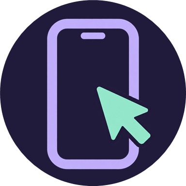
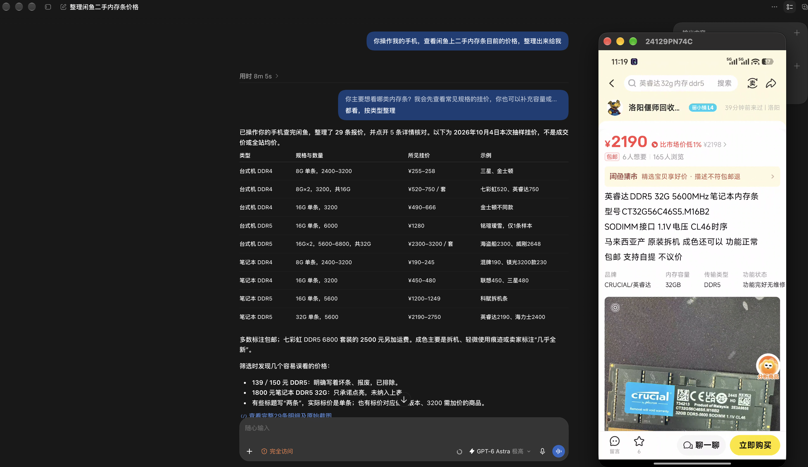
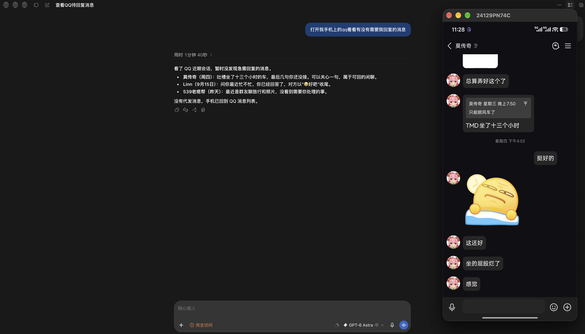
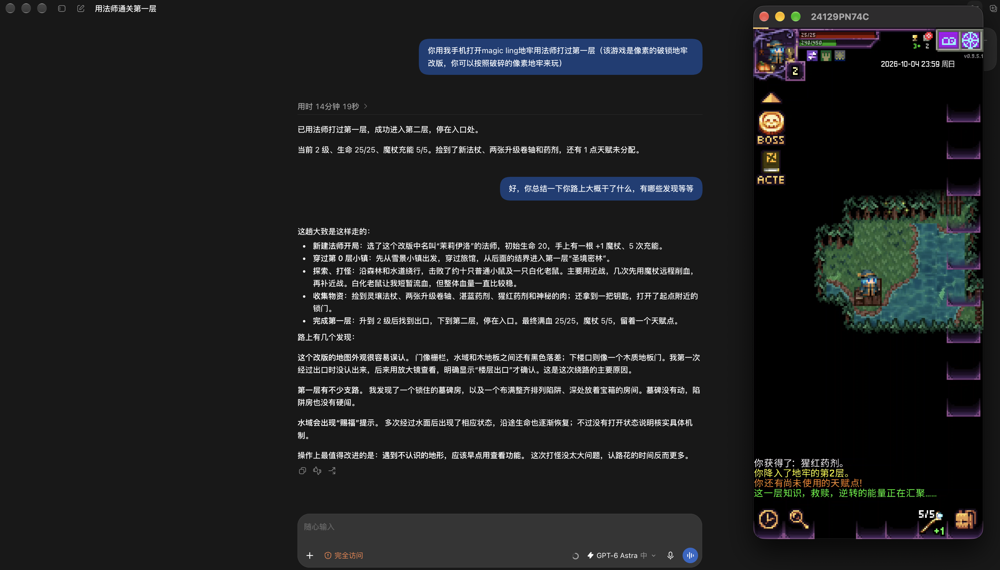
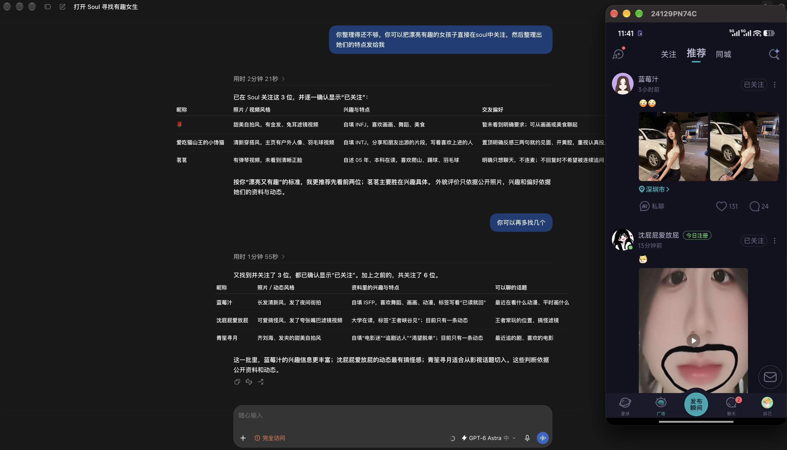

<div align="center">
  
  <h1>Phone Use</h1>
  <p><strong>Give AI agents control of your Android phone.</strong></p>
  <p>
    
    <a href="docs/integrations.md"></a>
    <a href="LICENSE"></a>
  </p>
  <p><a href="https://github.com/nidhoggfgg/PhoneUse/releases/latest"><strong>Download APK</strong></a> · <a href="#quick-start">Quick start</a> · <a href="#examples">Examples</a> · <a href="docs/usage.md">Docs</a></p>
  <p><strong>English</strong> | <a href="README.zh-CN.md">简体中文</a></p>
</div>

Phone Use connects your existing AI agent to your phone through **Skill or MCP**. The agent can read the screen, tap, swipe, type, and switch apps—**no root, ADB, or per-app integration required**.

## Examples

<table>
  <tr>
    <td width="50%" valign="top">
      <p><strong>Compare prices on Xianyu</strong><br>Collect 29 RAM offers and check item details.</p>
      <a href="docs/images/secondhand-shopping.webp"></a>
    </td>
    <td width="50%" valign="top">
      <p><strong>Catch up on QQ messages</strong><br>Review recent chats and find messages worth a reply.</p>
      <a href="docs/images/message-review.webp"></a>
    </td>
  </tr>
  <tr>
    <td width="50%" valign="top">
      <p><strong>Play a roguelike</strong><br>Explore, fight, and clear the first floor as a mage.</p>
      <a href="docs/images/roguelike.webp"></a>
    </td>
    <td width="50%" valign="top">
      <p><strong>Discover people on Soul</strong><br>Follow profiles and summarize their interests.</p>
      <a href="docs/images/social-discovery.webp"></a>
    </td>
  </tr>
</table>

## Quick start

You'll need an **Android 11+ phone** and an **AI agent that can run programs**, with **Python 3.10+** in its execution environment. Connect the phone and agent's computer to the same Wi-Fi, or another network where the phone is reachable.

1. **Install the app.** [Download the APK](https://github.com/nidhoggfgg/PhoneUse/releases/latest), install it on your phone, and open Phone Use.
2. **Grant permissions.** Enable **Accessibility** and allow notification and local-network permissions when prompted.
3. **Connect your agent.** In **Connect your AI**, select a reachable phone address, tap **Copy prompt**, and send the whole prompt to your agent. It installs the Skill and starts pairing.

For the first connection, compare the **eight-digit code** on your phone with the one shown by the agent. If they match, approve on the phone and tell the agent you've confirmed the match.

**Pair once, then just ask your agent to use your phone.** Pairings survive restarts; removing pairing data or revoking access requires pairing again. Keep the phone awake and unlocked during use.

### Manual Skill installation

With **Node.js 22.20+**, **Git**, and **Python 3.10+** installed:

```sh
npx skills add nidhoggfgg/phone-use-skills --skill phone-use
```

Choose your agent and installation scope, then send it the following, replacing the address with the **HTTPS address shown in the app**:

> Use the phone-use Skill to connect to https://192.168.1.20:8443. Show me the pairing code and wait for my confirmation.

Complete the same code check above. The Skill handles both pairing and phone control; no separate MCP setup is needed.

## Features

- **Screen understanding** — UI elements and screenshots give agents the context to act.
- **App interaction** — Tap, long-press, swipe, scroll, type, launch apps, and navigate.
- **Your agent, your devices** — Connect through Skill, MCP, or the Python CLI, with support for multiple phones.
- **On-device authorization** — Approve clients on your phone, connect over HTTPS with Skill/MCP, and revoke access at any time.

## Documentation

[Usage & troubleshooting](docs/usage.md) · [Skill & MCP setup](docs/integrations.md) · [API reference](docs/api.md) · [Build from source](docs/validation.md)

[Contributing](CONTRIBUTING.md) · [Report an issue](https://github.com/nidhoggfgg/PhoneUse/issues) · [Security policy](SECURITY.md)

## License

[MIT](LICENSE)
